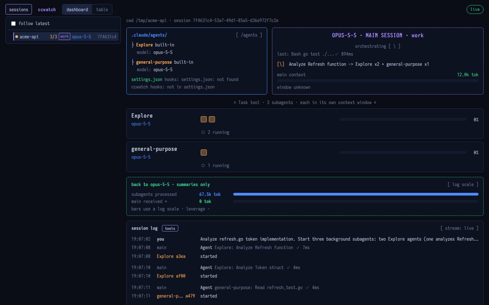
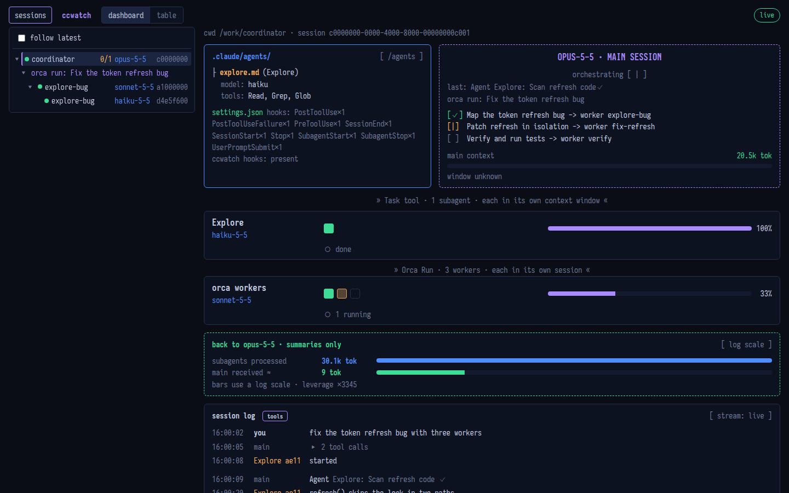
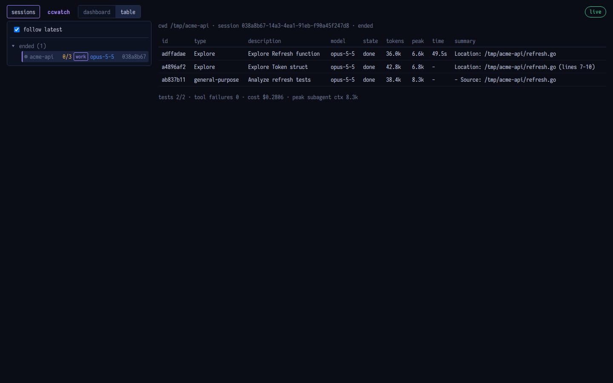
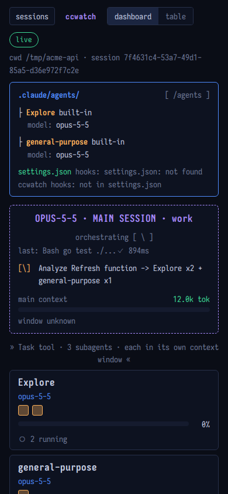
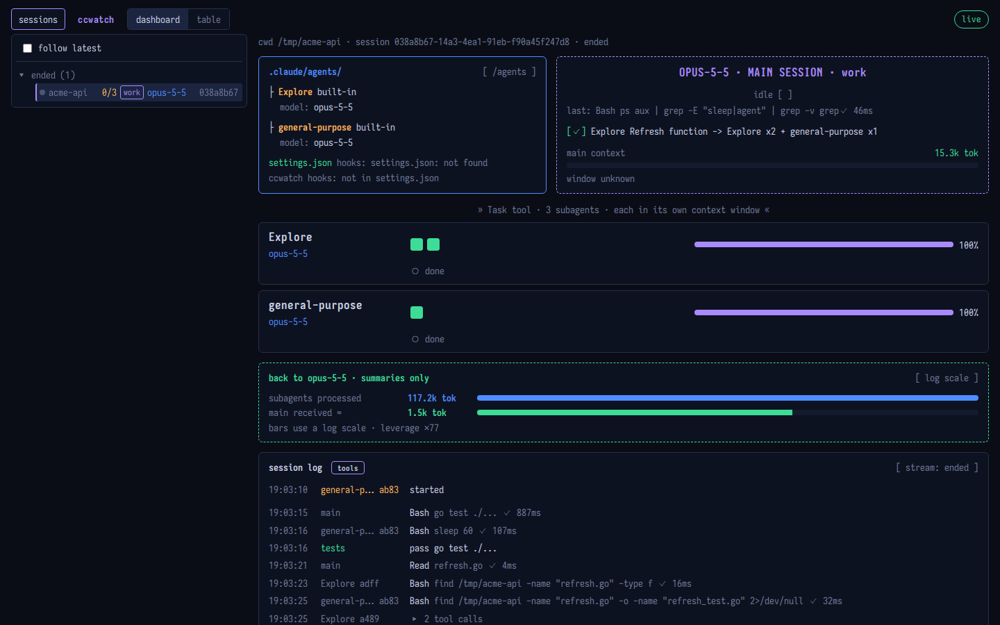
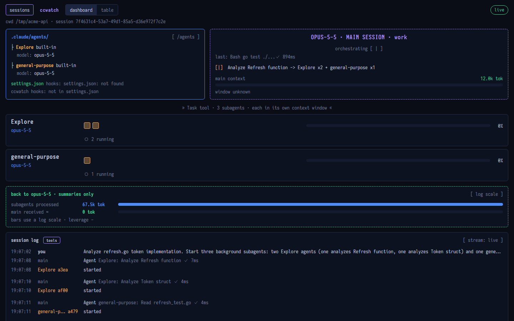
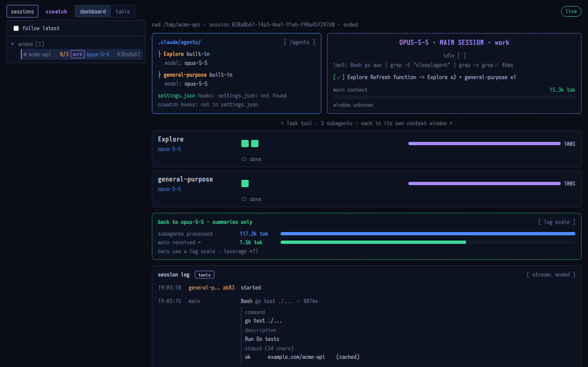

# ccwatch

A read-only live view of what Claude Code is doing: which subagents are running, how many tokens each one used, how large the main context is, whether tests pass, and (optionally) which Orca workers belong to a session. It runs as a small local service and shows the result as a terminal UI, a web page, and one extra line in your Claude Code status line. It never talks to Claude Code's API and never changes a session; it only listens.



## How it works

Claude Code reports on itself through three channels. ccwatch reads all three and joins them per session:

```
 Claude Code session
   |
   |-- hooks (command, async) ----> ccwatch hook   --> <state>/events/<session>.jsonl   what happened
   |                                                    (prompts, subagent start/stop, tool results)
   |-- OpenTelemetry logs (HTTP) -> ccwatch serve  --> <state>/otel/<session>.jsonl     what it cost
   |                                                    (tokens per request, per agent_id)
   '-- status line (stdin JSON) --> ccwatch line   --> <state>/ctx/<session>.json       how big the window is
                                                         |
              ccwatch tui / web page / ccwatch line  <---'   read, join, render
```

- **Hooks give events.** `ccwatch hook` reads one hook payload from stdin, keeps a trimmed copy, appends it to the session's events file and always exits 0, so it can never fail a session.
- **OTLP gives tokens.** `ccwatch serve` is an OTLP/HTTP JSON receiver. It keeps only `api_request` and `subagent_completed` records and joins them to subagents through `agent_id`.
- **The status line gives the context window.** `ccwatch line` records the context window size Claude Code reports, so the views can show a percentage instead of `window unknown`.

The terminal UI and the web page read those files; nothing is sent anywhere.

## Requirements

- Claude Code 2.1.310 or newer. Older versions do not put `agent_id` on `api_request` events, so per-subagent tokens cannot be attributed. Verified on 2.1.319.
- Go 1.25 to build.
- Linux is the verified platform. macOS builds but is untested; Windows is untested.
- `jq` for the settings merge snippet below (optional, you can edit the JSON by hand).
- Optional: the Orca terminal app and its `orca` CLI, for the Orca Run and worker panels.

## Install

```sh
go install github.com/toniim/ccwatch@latest
# or from a checkout:
go build -o ~/.local/bin/ccwatch .
```

`go install` puts the binary in `$(go env GOPATH)/bin` (usually `~/go/bin`). Use the absolute path of the binary in the hooks below.

### 1. Hooks

`ccwatch demo` prints the hooks block for your binary (the path is the binary's own absolute path). Output, with `/home/you/go/bin/ccwatch` standing in for your path:

```json
{
  "hooks": {
    "PostToolUse": [
      {
        "hooks": [
          {
            "async": true,
            "command": "/home/you/go/bin/ccwatch hook",
            "type": "command"
          }
        ],
        "matcher": "*"
      }
    ],
    "PostToolUseFailure": [
      {
        "hooks": [
          {
            "async": true,
            "command": "/home/you/go/bin/ccwatch hook",
            "type": "command"
          }
        ],
        "matcher": "*"
      }
    ],
    "PreToolUse": [
      {
        "hooks": [
          {
            "async": true,
            "command": "/home/you/go/bin/ccwatch hook",
            "type": "command"
          }
        ],
        "matcher": "*"
      }
    ],
    "SessionEnd": [
      {
        "hooks": [
          {
            "async": true,
            "command": "/home/you/go/bin/ccwatch hook",
            "type": "command"
          }
        ],
        "matcher": "*"
      }
    ],
    "SessionStart": [
      {
        "hooks": [
          {
            "async": true,
            "command": "/home/you/go/bin/ccwatch hook",
            "type": "command"
          }
        ],
        "matcher": "*"
      }
    ],
    "Stop": [
      {
        "hooks": [
          {
            "async": true,
            "command": "/home/you/go/bin/ccwatch hook",
            "type": "command"
          }
        ],
        "matcher": "*"
      }
    ],
    "SubagentStart": [
      {
        "hooks": [
          {
            "async": true,
            "command": "/home/you/go/bin/ccwatch hook",
            "type": "command"
          }
        ],
        "matcher": "*"
      }
    ],
    "SubagentStop": [
      {
        "hooks": [
          {
            "async": true,
            "command": "/home/you/go/bin/ccwatch hook",
            "type": "command"
          }
        ],
        "matcher": "*"
      }
    ],
    "UserPromptSubmit": [
      {
        "hooks": [
          {
            "async": true,
            "command": "/home/you/go/bin/ccwatch hook",
            "type": "command"
          }
        ],
        "matcher": "*"
      }
    ]
  }
}
```

To add it to `~/.claude/settings.json` without losing your existing hooks, this appends the ccwatch entries per event and writes a backup first. Running it again replaces the old ccwatch entries instead of duplicating them:

```sh
cp ~/.claude/settings.json ~/.claude/settings.json.bak
ccwatch demo 2>/dev/null > /tmp/ccwatch-hooks.json
jq --slurpfile new /tmp/ccwatch-hooks.json '
  .hooks = reduce ($new[0].hooks | keys[]) as $k (.hooks // {};
    .[$k] = ((.[$k] // [] | map(select(([.hooks[]?.command] | any(endswith("ccwatch hook"))) | not))) + $new[0].hooks[$k]))
' ~/.claude/settings.json > /tmp/settings.merged.json && mv /tmp/settings.merged.json ~/.claude/settings.json
```

If `~/.claude/settings.json` does not exist yet, create it with `{}` first.

### 2. Telemetry environment

Claude Code exports tokens through OpenTelemetry. `ccwatch demo` prints these six lines on stderr:

```sh
export CLAUDE_CODE_ENABLE_TELEMETRY=1
export OTEL_LOGS_EXPORTER=otlp
export OTEL_METRICS_EXPORTER=otlp
export OTEL_EXPORTER_OTLP_PROTOCOL=http/json
export OTEL_EXPORTER_OTLP_ENDPOINT=http://127.0.0.1:4319
export OTEL_LOGS_EXPORT_INTERVAL=1000
```

To make them permanent, put the same keys in the `env` block of `~/.claude/settings.json` (values as strings):

```json
{
  "env": {
    "CLAUDE_CODE_ENABLE_TELEMETRY": "1",
    "OTEL_LOGS_EXPORTER": "otlp",
    "OTEL_METRICS_EXPORTER": "otlp",
    "OTEL_EXPORTER_OTLP_PROTOCOL": "http/json",
    "OTEL_EXPORTER_OTLP_ENDPOINT": "http://127.0.0.1:4319",
    "OTEL_LOGS_EXPORT_INTERVAL": "1000"
  }
}
```

Hooks are picked up by running sessions without a restart. Environment variables are read at session start, so **restart each Claude Code session** after setting them.

### 3. Run the server

```sh
ccwatch serve                       # listens on 127.0.0.1:4319
ccwatch serve --addr 127.0.0.1:4411 # another port; change OTEL_EXPORTER_OTLP_ENDPOINT to match
```

It serves the OTLP receiver (`/v1/logs`) and the web view on the same port. Keep it running while you use Claude Code; see the service units below.

### Run `serve` as a service

systemd user unit, `~/.config/systemd/user/ccwatch-serve.service`:

```ini
[Unit]
Description=ccwatch: OTLP receiver and web view for Claude Code sessions

[Service]
Environment=PATH=%h/.config/orca/cli/bin:/usr/local/bin:/usr/bin:/bin
ExecStart=%h/.local/bin/ccwatch serve --addr 127.0.0.1:4319
Restart=on-failure
RestartSec=2

[Install]
WantedBy=default.target
```

```sh
systemctl --user daemon-reload
systemctl --user enable --now ccwatch-serve
```

`Environment=PATH=` matters only if you use Orca: a systemd user service has a minimal `PATH`, so the `orca` CLI must be on it (adjust the first entry to where your `orca` lives) or the Orca panels stay empty. Alternatively set `CCWATCH_ORCA=/full/path/to/orca`.

macOS launchd, `~/Library/LaunchAgents/dev.ccwatch.serve.plist` (**untested**):

```xml
<?xml version="1.0" encoding="UTF-8"?>
<!DOCTYPE plist PUBLIC "-//Apple//DTD PLIST 1.0//EN" "http://www.apple.com/DTDs/PropertyList-1.0.dtd">
<plist version="1.0">
<dict>
  <key>Label</key><string>dev.ccwatch.serve</string>
  <key>ProgramArguments</key>
  <array>
    <string>/Users/you/go/bin/ccwatch</string>
    <string>serve</string>
    <string>--addr</string>
    <string>127.0.0.1:4319</string>
  </array>
  <key>EnvironmentVariables</key>
  <dict>
    <key>PATH</key><string>/usr/local/bin:/usr/bin:/bin</string>
  </dict>
  <key>RunAtLoad</key><true/>
  <key>KeepAlive</key><true/>
</dict>
</plist>
```

```sh
launchctl load ~/Library/LaunchAgents/dev.ccwatch.serve.plist
```

### 4. Status line (context window)

Claude Code passes the context window size to the status line command, and only there. `ccwatch line` reads that JSON on stdin, records the window size for the session, and prints one line:

```
Opus | idle | agents 0 live | workers 2/2 | ctx 30k 15% | tests 0/0
```

Without it the views show `window unknown` for the main context. If you already have a status line script, wrap it and let ccwatch add a second line:

```sh
#!/bin/sh
# ~/.claude/statusline-combined.sh
input=$(cat)
printf '%s\n' "$input" | sh "$HOME/.claude/my-statusline.sh"   # your existing script
printf '%s\n' "$input" | /home/you/go/bin/ccwatch line
```

```json
{
  "statusLine": {
    "type": "command",
    "command": "sh \"$HOME/.claude/statusline-combined.sh\"",
    "refreshInterval": 3
  }
}
```

`refreshInterval` re-runs the command on a timer, so the line (and the recorded window size) keep updating while the session is idle. If you have no status line yet, use `"command": "/home/you/go/bin/ccwatch line"` directly.

## Usage

**Terminal UI**

```sh
ccwatch tui                    # follows the most recently active session
ccwatch tui --session <id>     # a specific session
ccwatch tui --table            # start in the table view
ccwatch tui --all-workers      # show every Orca dispatch, not only active ones
ccwatch tui --once --width 120 # print one frame and exit (also good for scripts and docs)
```

Keys: `t` toggles the table view, `tab` switches to the next session (and stops following the newest), `q` quits.

One frame (`ccwatch tui --once --width 120`):

```
ccwatch  session c3014d9e (ended)  cwd /tmp/acme-api
┌─ .claude/agents/ ─────────────── [ /agents ] ┐ ┌╌╌╌╌╌╌╌╌╌╌╌╌╌╌╌╌╌╌╌╌╌╌╌╌╌╌╌╌╌╌╌╌╌╌╌╌╌╌╌╌╌╌╌╌╌╌╌╌╌╌╌╌╌╌╌╌╌╌╌╌╌╌╌╌╌╌╌╌╌┐
│ ├ Explore  built-in                          │ ╎                     MAIN · main session · work                      ╎
│     model: ?                                 │ ╎                             idle [   ]                              ╎
│ ├ general-purpose  built-in                  │ ╎                                                                     ╎
│     model: ?                                 │ ╎ [|] subagent launches -> Explore x2 + general-purpose x1            ╎
│                                              │ ╎                                                                     ╎
│ settings.json                                │ ╎ main context                                                  0 tok ╎
│ hooks: PostToolUse×1 PostToolUseFailure×1    │ ╎ window unknown · cost $0.0000                                       ╎
│        SessionEnd×1 SessionStart×1 Stop×1    │ ╎                                                                     ╎
│        SubagentStart×1 SubagentStop×1 …      │ ╎                                                                     ╎
│ ccwatch hooks: present                       │ ╎                                                                     ╎
└──────────────────────────────────────────────┘ └╌╌╌╌╌╌╌╌╌╌╌╌╌╌╌╌╌╌╌╌╌╌╌╌╌╌╌╌╌╌╌╌╌╌╌╌╌╌╌╌╌╌╌╌╌╌╌╌╌╌╌╌╌╌╌╌╌╌╌╌╌╌╌╌╌╌╌╌╌┘
                              » Task tool · 3 subagents · each in its own context window «                              
┌──────────────────────────────────────────────────────────────────────────────────────────────────────────────────────┐
│ Explore           □ □                                                                    ░░░░░░░░░░░░░░░░░░░░░░   0% │
│ ?                 ○ queued                                                                                           │
└──────────────────────────────────────────────────────────────────────────────────────────────────────────────────────┘
┌──────────────────────────────────────────────────────────────────────────────────────────────────────────────────────┐
│ general-purpose   □                                                                      ░░░░░░░░░░░░░░░░░░░░░░   0% │
│ ?                 ○ queued                                                                                           │
└──────────────────────────────────────────────────────────────────────────────────────────────────────────────────────┘
┌╌ back to main · summaries only ╌╌╌╌╌╌╌╌╌╌╌╌╌╌╌╌╌╌╌╌╌╌╌╌╌╌╌╌╌╌╌╌╌╌╌╌╌╌╌╌╌╌╌╌╌╌╌╌╌╌╌╌╌╌╌╌╌╌╌╌╌╌╌╌╌╌╌╌╌╌╌ [ log scale ] ┐
╎ subagents processed   0 tok       ░░░░░░░░░░░░░░░░░░░░░░░░░░░░░░░░░░░░░░░░░░░░░░░░░░░░░░░░░░                         ╎
╎ main received ≈       0 tok       ░░░░░░░░░░░░░░░░░░░░░░░░░░░░░░░░░░░░░░░░░░░░░░░░░░░░░░░░░░                         ╎
╎ bars use a log scale · leverage - · peak subagent ctx 0                                                              ╎
└╌╌╌╌╌╌╌╌╌╌╌╌╌╌╌╌╌╌╌╌╌╌╌╌╌╌╌╌╌╌╌╌╌╌╌╌╌╌╌╌╌╌╌╌╌╌╌╌╌╌╌╌╌╌╌╌╌╌╌╌╌╌╌╌╌╌╌╌╌╌╌╌╌╌╌╌╌╌╌╌╌╌╌╌╌╌╌╌╌╌╌╌╌╌╌╌╌╌╌╌╌╌╌╌╌╌╌╌╌╌╌╌╌╌╌╌╌╌┘
┌─ session log ───────────────────────────────────────────────────────────────────────────────────── [ stream: ended ] ┐
│ 18:09:25  you                    Analyze the token refresh logic in refresh.go and refresh_test.go. Start two Explo… │
│ 18:09:32  Explore af27           started                                                                             │
│ 18:09:34  Explore a4e7           started                                                                             │
│ 18:09:36  general-purpose a3f7   started                                                                             │
└──────────────────────────────────────────────────────────────────────────────────────────────────────────────────────┘
tests 0/0 · tool failures 0 · t table · tab next · q quit
```

**Web view**

Open <http://127.0.0.1:4319/>. Sessions are listed as a tree in the left sidebar: coordinators with their Orca Run and worker sessions, `claude -p` sessions nested under the session that started them, standalone sessions, and an "ended" group. Click a node to pin that session (`?session=<id>` in the URL); "follow latest" at the top of the sidebar jumps to the newest one. Hide or show the sidebar with the "sessions" button or the `[` key, and drag its right edge to resize it (double-click resets); below 900 px it opens as a drawer. Switch between the dashboard and the table with the buttons at the top. It updates live (server-sent events).

The main session panel shows what the session is doing now: a `now:` line when a tool is running, or `last:` with the most recent tool when idle. Each tool row in the session log shows which tool was called; click the row to expand it and see the full parameters and, for Bash commands, a preview of stdout/stderr (head + tail).

| Overview | Orca Run | Table | Mobile Drawer |
|---|---|---|---|
|  |  |  |  |

| Session log | Sidebar hidden | Profile tag |
|---|---|---|
|  |  |  |

**Expanded tool row** (Bash with parameters and output preview):



**Status line**

`ccwatch line` as shown above.

**Housekeeping**

```sh
ccwatch prune --dry-run         # list what would be deleted, delete nothing
ccwatch prune --max-age 720h    # delete state of sessions idle longer than that
```

### Orca integration (optional)

If the Orca terminal app is installed, ccwatch also shows the Orca Run a coordinator session owns (its tasks and workers) and, on a worker session, a one-line link back to its run. This needs nothing in Orca: the hook records `$ORCA_TERMINAL_HANDLE` (the only `ORCA_*` variable ever read) and the server asks the `orca` CLI (`orca orchestration worker-list --json` and related commands, 4 s cap) for the rest. The CLI is looked up in this order: `$CCWATCH_ORCA`, `$ORCA_CLI_COMMAND`, `~/.config/orca/cli/bin/orca`, then `orca` on `PATH` (the GNOME screen reader at `/usr/bin/orca` is skipped). Without Orca the panels simply do not appear.

## Data and privacy

Everything stays on your machine, in the state directory: `$CCWATCH_STATE`, else `${XDG_STATE_HOME:-~/.local/state}/ccwatch`.

| Path | Written by | Contains |
|---|---|---|
| `events/<session>.jsonl` | `ccwatch hook` | A trimmed copy of each hook payload: session id, `cwd`, event name, ids. Your prompt **in full** (bounded only by the 1 MiB hook stdin cap) with its kind and length; the views show a one-line preview, and the web view fetches the full text from `/api/prompt` only when you expand a row (an Orca dispatch wrapper only on request). The assistant's last message and subagent prompts truncated to 300 characters (the first part of the text). Tool inputs **in full** (up to 16 KiB per string field, with `_chars` suffix for longer ones), plus Bash stdout/stderr previews (head + tail, up to 1000 characters each). For a session run under another Claude profile (`CLAUDE_CONFIG_DIR`): that profile's short name and its config dir relative to `$HOME` (only when it is under `$HOME`), used to tag the session and read that profile's `settings.json` and agents; no full path or other variable is stored. |
| `otel/<session>.jsonl` | `ccwatch serve` | Only `api_request` and `subagent_completed` records (model, token counts, cost, `agent_id`, `query_source`, request ids). Attributes starting with `user.`, `organization.` or `anthropic.` (identity of the signed-in user) are dropped before writing. Files are created with mode 0644. |
| `ctx/<session>.json` | `ccwatch line` | The context window size. |
| `workers.json` | `ccwatch` | A short-lived cache of the Orca worker list. |

Prompts, assistant text, tool inputs, and commands from your sessions therefore do end up in these files. Treat the state directory like your shell history.

Network exposure: `serve` defaults to `127.0.0.1:4319`. When the address is loopback, the web page and `/api/*` only answer requests whose `Host` header is a loopback name (`localhost`, `127.0.0.1`, `::1`), which blocks DNS-rebinding. Binding to a LAN address turns this Host check off: anyone who can reach the address can read prompts, tool inputs, and commands from every session in the state directory. The OTLP endpoints are not authenticated.

The web page loads the font Iosevka Charon Mono from Google Fonts (`fonts.googleapis.com`), so the browser contacts Google when you open it; it falls back to a system monospace font offline.

Retention: `serve` prunes at start and every 6 hours. Sessions idle for more than 30 days (`CCWATCH_MAX_AGE`, default `720h`, matching Claude Code's own transcript cleanup; `serve --prune-max-age 0` disables) are deleted with all their files. A `ctx` or `otel` file with no matching events file is an orphan and goes after 24 hours. `ccwatch prune` does the same by hand and never touches files it did not create.

Environment variables ccwatch reads: `CCWATCH_STATE`, `XDG_STATE_HOME`, `CCWATCH_MAX_AGE`, `CCWATCH_CLAUDE_HOME` (where to look for `settings.json` and `agents/`, default `~/.claude`), `CCWATCH_ORCA`, `ORCA_CLI_COMMAND`, `ORCA_TERMINAL_HANDLE`.

## Uninstall

1. Remove the ccwatch entries from `hooks` in `~/.claude/settings.json` (or restore `settings.json.bak`), the six telemetry keys from `env`, and the `ccwatch line` call from your status line script.
2. Stop the service: `systemctl --user disable --now ccwatch-serve` and delete the unit (macOS: `launchctl unload` the plist and delete it).
3. Delete the binary and the state directory (`rm -rf ~/.local/state/ccwatch`).

## Troubleshooting

- **No tokens or costs shown.** Either `ccwatch serve` is not running, or the session was started before the telemetry environment was set. Check `curl -s http://127.0.0.1:4319/api/sessions`, then restart the Claude Code session. Hooks hot-reload; environment variables do not.
- **Sessions from another profile never show up.** A launcher that sets `CLAUDE_CONFIG_DIR` makes Claude Code read `$CLAUDE_CONFIG_DIR/settings.json` instead of `~/.claude/settings.json`. Add the same hooks and telemetry `env` block to that profile's `settings.json`; its sessions then appear tagged with the profile name.
- **`window unknown`.** The status line is not wired to `ccwatch line` (step 4), or the session has not rendered a status line yet.
- **The page looks unstyled or old after an update.** Hard reload the page (Ctrl/Cmd+Shift+R).
- **Orca panels are empty under systemd.** The service cannot find the `orca` CLI: add its directory to `Environment=PATH=` or set `CCWATCH_ORCA`.
- **`address already in use`.** Another process holds the port. Find it with `ss -ltnp | grep 4319`, stop it, or pick another port with `--addr` and update `OTEL_EXPORTER_OTLP_ENDPOINT`.
- **Nothing at all.** Run `ccwatch tui --once` to see whether any state exists, and look at `<state>/events/`.

## Development

```sh
go vet ./...
go test ./...
go test ./internal/pipeline -update   # rewrite the golden TUI frames after an intended change
```

`ccwatch hook` is covered by a timing test; the fixtures under `testdata/` are synthetic. `scripts/` holds a few demo helpers (`demo.sh`, `web-demo.sh`, `fake-orca.sh`).

## License

MIT, see [LICENSE](LICENSE).
